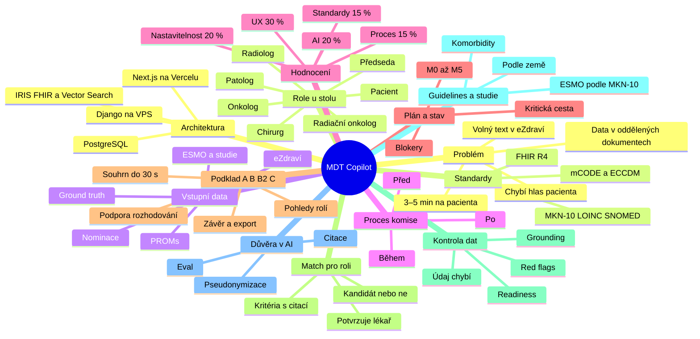

# MDT Copilot — myšlenková mapa projektu

> Přehled celého projektu na jednom místě: zadání z prezentace, poznámky z konzultace se zadavateli, architektura z [ARCHITEKTURA.md](ARCHITEKTURA.md) a stav z [PROGRESS.md](PROGRESS.md). Stav odpovídá pátku 16. 10. odpoledne.
>
> Značky: _(poznámka)_ = zaznělo na konzultaci se zadavateli · ⚠️ **mezera** = v návrhu zatím chybí.

**MDT Copilot** je AI asistent pro onkologické konzilium. Z dat pacienta za pár sekund připraví podklad pro každého člena komise a zapíše rozhodnutí jako oficiální záznam ve FHIR.

**Zlaté pravidlo:** AI připravuje, shrnuje, upozorňuje a navrhuje. Rozhoduje vždy lékař.

---

## Kontext: proč, pro koho, s čím

### Problém

- Na jednoho pacienta zbývá 3–5 minut, rozhodnutí musí padnout v řádu minut _(poznámka)_.
- Data jsou v oddělených dokumentech: zprávy, PACS, předchozí vyšetření. Z nich je potřeba vytáhnout to nejdůležitější _(poznámka)_.
- Nálezy v eZdraví jsou volný text, nic se nesčítá samo.
- Chybí hlas pacienta: dotazník PROMs není s komisí propojený.
- Špatně zvolené pořadí léčby se těžko napravuje.

### Kdo sedí u stolu

Každá role chce vidět něco jiného _(poznámka)_.

| Role | Co potřebuje vidět |
|---|---|
| Předseda | nastaví podklad, potvrdí závěr |
| Chirurg | lze operovat, rozsah TNM, předchozí operace _(poznámka)_ |
| Klinický onkolog | biomarkery, linie léčby, nežádoucí účinky |
| Radiolog | vývoj nálezů v čase, RECIST 1.1 |
| Patolog | histologie, grade, ICD-O-3 |
| Radiační onkolog | předchozí ozařování, oblasti, dávky |
| Pacient | trend PROMs, symptomy, preference |

### Vstupní data

Smyšlená data od Asseco, formát zatím neznámý (Q1).

- eZdraví: propouštěcí zprávy, krev a onkomarkery, popisy CT/MRI, léky.
- PROMs: EORTC QLQ-C30 a PRO-CTCAE, aspoň 2 vyplnění v čase.
- Nominace: kdo posílá, s jakou otázkou, předchozí závěry.
- Výtah z ESMO guidelines + 3–5 smyšlených klinických studií.
- 3–5 pacientů se schválně vloženými chybami a ground truth.
- Bonus: přepis diskuse komise pro AI zapisovatele.
- PACS: počítáme jen s textovými popisy, samotné snímky jsou mimo rozsah _(poznámka)_ ⚠️ **mezera**

### Proces komise

Copilot má pokrýt všechny 3 fáze.

1. **Před:** nominace s otázkou (`ServiceRequest`), kontrola úplnosti, agenda.
2. **Během:** přepínání pacientů, prezentační režim na projektor, AI zapisovatel převede přepis na draft závěru.
3. **Po:** úkoly s termíny, kontrola plnění, opětovné posouzení.

### Hodnocení

| Kritérium | Váha |
|---|---|
| Klinická hodnota a UX | 30 % |
| Spolehlivost AI | 20 % |
| Nastavitelnost | 20 % |
| Data a standardy | 15 % |
| Proces a zodpovědná AI | 15 % |
| Bonusy (kvalita, ne počet) | +10 % |

- Finále: 5 minut, jeden pacient, celý cyklus komise živě.
- Výzva InterSystems: 1. místo 1 500 EUR, kombinovatelná s MDT Copilot.

### Plán a stav

- Kód je zatím čistý template (Hackathon OS), MDT moduly neexistují.
- Z 50 úkolů v PROGRESS.md není žádný hotový ani zabraný. Lanes INFRA, DATA, AI, API, UI a PITCH nemají ownera.
- Kritická cesta: `T-002` → `T-003` → `T-008` → `T-101` → `T-105` → `T-106` → `T-108`.
- Milníky: M0 Pá 18:00 · M1 Pá 23:00 · M2 So 04:00 · M3 So 09:00 · freeze So 10:00 · **odevzdání So 12:00** · pitch 13:00.
- Blokery: dataset (Q1), LLM klíč (Q2), server (Q3).

---

## Řešení: co stavíme

### Podklad A · B · B2 · C

- **A Souhrn do 30 s:** diagnóza, TNM, ECOG lékař vs. pacient, časová osa, otázka komise _(poznámka)_.
- **B Pohled každé přítomné role**, povinně aspoň 3.
- **B2 Podpora rozhodování:**
  - možnosti léčby z guidelines s citací, AI nevybírá;
  - screening studií: splňuje / nesplňuje / nelze určit;
  - dvě až tři otázky k diskusi.
- **C Závěr:** rozhodnutí, zdůvodnění, úkoly, export PDF a FHIR _(poznámka)_.

### Match pro roli

Je pacient pro tuhle roli kandidát? Nápad z konzultace _(poznámka)_.

- Pro každou roli předběžné posouzení: kandidát / ne / podmíněně / chybí data.
- Chirurg: resekabilita, ECOG, komorbidity, předchozí operace.
- Vyhodnotit po kritériích s citací, stejně jako screening studií.
- Verdikt je jen podklad, potvrzuje ho lékař dané role.
- Návrh postupu operace jde do B2 jako jedna z možností _(poznámka)_.
- V kontraktu (ARCHITEKTURA §8) zatím chybí pole pro posouzení role. ⚠️ **mezera**

### Kontrola dat a varování

Warning systém _(poznámka)_.

- Red flags: rozpor mezi zdroji, závažnost, citace obou zdrojů.
- Pravidla `RF-ECOG`, `RF-HB-FATIGUE`, `RF-MARKER`, `RF-TOX`, `RF-STALE`, `RF-MISSING` + rozpory od LLM.
- Readiness: chybí histologie, zobrazení je staré, chybí biomarker.
- Grounding validátor: sedí citace, čísla i data.
- „Údaj chybí v podkladech“ místo hádání.
- Varování „už operován“, implantáty, alergie: chybí pravidlo i FHIR typ _(poznámka)_ ⚠️ **mezera**
- Přiřazení dokumentu ke správnému pacientovi a roli _(poznámka)_ ⚠️ **mezera**

### Guidelines a studie

- Hledání v ESMO podle typu nádoru (prefix MKN-10, např. C18).
- Postupy se liší podle diagnózy i země, chybí rozlišení zdroje a regionu _(poznámka)_ ⚠️ **mezera**
- Kombinované choroby (diabetes + rakovina) mění kritéria studií _(poznámka)_ ⚠️ **mezera**
- Studie jako `ResearchStudy` + kritéria inclusion / exclusion.
- Kandidát do studie se zapíše jen po potvrzení komisí.

### Důvěra v AI

Čtyři pravidla zadání a jak je plníme:

| Pravidlo | Jak |
|---|---|
| Nastavitelnost | předseda nakliká sekce, pořadí, role, detail, presety |
| Varovné signály | red flags se závažností a citací obou zdrojů |
| Dohledatelnost | každé tvrzení má Evidence ID a zdroj na jeden klik |
| Člověk rozhoduje | AI text má štítek „AI návrh“, potvrzení podepíše lékař |

- Pipeline: ingest → kontext → generace → validace → review → zápis.
- Pseudonymizace před LLM, zpracování v EU, žádné PII v logu.
- Eval proti ground truth dá čísla do pitche.

### Architektura

- Next.js 16 na Vercelu: jen UI, žádné klíče.
- Django 4.2 + DRF na VPS: orchestrace AI, pravidla, FHIR.
- IRIS for Health: FHIR R4 jako nemocniční databáze.
- IRIS Vector Search: RAG vždy s filtrem na pacienta.
- PostgreSQL: jen uživatelé, drafty, presety, logy.
- Generování jako job + polling, cíl pod 20 s.
- Model a provider LLM zatím nevybrán (`D-008`). ⚠️ **mezera**

### Standardy a FHIR

- Vstup: `Patient`, `Condition`, `Observation`, `DiagnosticReport`, `DocumentReference`…
- Zápis do IRIS: `CarePlan`, `Task`, `DetectedIssue`, `Provenance`, `Composition` _(poznámka: výstup ve FHIRu)_.
- Kódy: MKN-10, ICD-O-3, LOINC, SNOMED CT, ATC.
- Bonus: profily mCODE / ECCDM v exportu, `$validate` v IRIS.
- Komorbidity a alergie v datovém modelu (ARCHITEKTURA §4.3) chybí. ⚠️ **mezera**

---

## Poznámky z konzultace vs. návrh

| Poznámka z konzultace | Kde je v návrhu | Stav a co doplnit |
|---|---|---|
| Krátká doba, rozhodnutí za 3–5 minut, přehledná appka | §1.1, souhrn do 30 s (FR-A1), `CaseHeader`, UX principy §7.3 | ✅ pokryto |
| Oddělené dokumenty, PACS, předchozí vyšetření → vytáhnout to nejdůležitější | Blok A, `context_builder` §5.1 | 🟨 částečně: PACS jen jako textové popisy (`DiagnosticReport`). V pitchi říct, že obrazová data DICOM jsou mimo rozsah prototypu. |
| Různé role v týmu (chirurg atd.) | Blok B, FR-B1 až B6, `RoleTabs` | ✅ pokryto |
| Operoval / neoperoval, „match“ pacienta pro roli | FR-B1 resekabilita, ale jen jako volný text | ⚠️ chybí: strukturované posouzení role, kritéria splněno / nesplněno / neznámo s citací a souhrnný stav (kandidát / podmíněně / ne / chybí data). Formulovat jako podklad, ne doporučení. Je to změna kontraktu §8 → `⚠️ KONTRAKT` v Deníku. |
| Přiřazování dokumentace | Ingest se stabilními ID (§4.4) | ⚠️ chybí: kontrola, že dokument patří pacientovi (věk, pohlaví, strana těla, datum), a zařazení dokumentu k roli. Dataset má schválně vložené chyby. Nové pravidlo red flag. |
| Chyby v datech, musíme mít kontrolu | Red flags §5.4, readiness (BON-1), grounding §5.3 | 🟨 částečně: doplnit pravidla kvality dat (data mimo pořadí, nesoulad jednotek, vlevo vs. vpravo, duplicitní nálezy). |
| Klinické postupy jiné pro diagnózu a zemi | `MDT.GuidelineChunk` s `CancerType` (§4.5) | ⚠️ chybí: k úsekům guidelines přidat zdroj a region (ESMO vs. národní doporučení), v B2 ukázat, odkud možnost pochází. Ověřit s mentory, co dataset obsahuje. |
| Návrh řešení pro operaci | B2 `treatment_options` (§5.5) | ✅ pokryto, jako možnost s citací, nikdy „doporučujeme“ |
| Data z klinických studií, kombinované choroby (diabetes + rakovina) | Screening studií FR-D2, `MDT.TrialCriterion` | ⚠️ chybí: komorbidity nejsou ve vstupním FHIR modelu. Přidat `Condition` s kategorií komorbidita, zobrazit v hlavičce, použít v kritériích studií i v posouzení chirurga. |
| Warning: defekty, jestli už byl operovaný | Pohled chirurga: předchozí operace (FR-B1) | 🟨 částečně: chybí samostatné varování. Přidat pravidlo pro předchozí výkon v téže oblasti, implantáty a alergie (`AllergyIntolerance` v modelu chybí). |
| Výstup ve FHIRu | Zápis do IRIS (§4.3 výstupy), export document Bundle (FR-C4) | ✅ pokryto |

---

## Co z toho plyne

### Doplnit do ARCHITEKTURA.md

- §8: typ pro posouzení role (kritéria + souhrnný stav + citace), zapsat jako změnu kontraktu.
- §4.3: komorbidity (`Condition`), alergie (`AllergyIntolerance`), případně implantáty (`Device`).
- §5.4: pravidla pro identitu dokumentu, předchozí operaci a kvalitu dat.
- §4.5: zdroj a region u guidelines.

### Rozjet práci

- Rozdělit lanes mezi lidi a zabrat úkoly M0, zatím jsou všechny volné.
- Získat dataset od Ľ. Piljana (Q1), bez něj stojí ingest.
- Vybrat LLM a klíč (Q2), bez něj stojí generování.
- Zeptat se mentorů na národní postupy a na prahy red flags (Q6).

---

Zdroje: `WEB_Template/MDT_Copilot_zadani_upravené_2026_v02.pptx` (13 slidů vč. poznámek řečníka), [ARCHITEKTURA.md](ARCHITEKTURA.md), [PROGRESS.md](PROGRESS.md), [AGENTS.md](AGENTS.md), `WEB_Template/` (backend a frontend), poznámky z konzultace se zadavateli.
