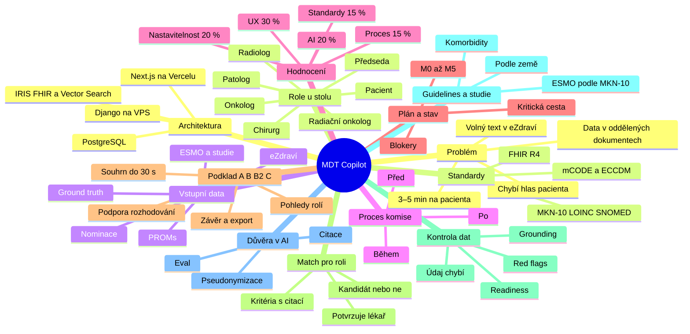

# MDT Copilot — myšlenková mapa projektu

> Přehled celého projektu na jednom místě: zadání z prezentace, poznámky z konzultace se zadavateli, architektura z [ARCHITEKTURA.md](ARCHITEKTURA.md) a stav z [PROGRESS.md](PROGRESS.md). Stav odpovídá pátku 16. 10. odpoledne.
>
> Značky: _(poznámka)_ = zaznělo na konzultaci se zadavateli · ⚠️ **mezera** = v návrhu zatím chybí.

**MDT Copilot** je AI asistent pro onkologické konzilium. Z dat pacienta za pár sekund připraví podklad pro každého člena komise a zapíše rozhodnutí jako oficiální záznam ve FHIR.

**Zlaté pravidlo:** AI připravuje, shrnuje, upozorňuje a navrhuje. Rozhoduje vždy lékař.

---

## Kontext: proč, pro koho, s čím

### Problém

- Na jednoho pacienta zbývá 3–5 minut, rozhodnutí musí padnout v řádu minut _(poznámka)_.
- Data jsou v oddělených dokumentech: zprávy, PACS, předchozí vyšetření. Z nich je potřeba vytáhnout to nejdůležitější _(poznámka)_.
- Nálezy v eZdraví jsou volný text, nic se nesčítá samo.
- Chybí hlas pacienta: dotazník PROMs není s komisí propojený.
- Špatně zvolené pořadí léčby se těžko napravuje.

### Kdo sedí u stolu

Každá role chce vidět něco jiného _(poznámka)_.

| Role | Co potřebuje vidět |
|---|---|
| Předseda | nastaví podklad, potvrdí závěr |
| Chirurg | lze operovat, rozsah TNM, předchozí operace _(poznámka)_ |
| Klinický onkolog | biomarkery, linie léčby, nežádoucí účinky |
| Radiolog | vývoj nálezů v čase, RECIST 1.1 |
| Patolog | histologie, grade, ICD-O-3 |
| Radiační onkolog | předchozí ozařování, oblasti, dávky |
| Pacient | trend PROMs, symptomy, preference |

### Vstupní data

Smyšlená data od Asseco, **dataset v1.1 už dorazil a je ve formátu FHIR R4**. Podrobně v [DATASET.md](DATASET.md). *(aktualizováno Pá 16:20)*

- **6 pacientů** (4× prs, 1× kolorektum, 1× plíce), každý jako FHIR Bundle se 142–215 resources.
- eZdraví: zprávy (`DocumentReference`), patologie a zobrazení (`DiagnosticReport`), laboratoř s trendy markerů, ECOG, biomarkery, TNM (`Observation`), léky, výkony.
- PROMs: vlastní dotazník `MDT-PROMS-1` (ne EORTC, kvůli licenci), 2 vyplnění v čase; otázka `samostatnost` = ECOG podle pacienta.
- Nominace: `ServiceRequest` + `Task`; předchozí MDT jako `Composition` + `CarePlan` + `CareTeam`.
- Guidelines: 4 výtahy (KRC, PRS, PLI, OBC) se 42 číslovanými pasážemi + 6 smyšlených studií (`RKT-01…06`).
- Schválně vložené chyby a mezery ano. **Ground truth zatím ne** (až po odevzdání), máme vlastní hypotézy (DATASET §9).
- Bonus přepis diskuse v datasetu **není**. Nahrajeme vlastní a přepíšeme ho Gemini.
- PACS: dataset má jen textové popisy s rozměry lézí, žádné DICOM. Snímky jsou mimo rozsah _(poznámka)_ ✅ potvrzeno datasetem

### Proces komise

Copilot má pokrýt všechny 3 fáze.

1. **Před:** nominace s otázkou (`ServiceRequest`), kontrola úplnosti, agenda.
2. **Během:** přepínání pacientů, prezentační režim na projektor, AI zapisovatel převede přepis na draft závěru.
3. **Po:** úkoly s termíny, kontrola plnění, opětovné posouzení.

### Hodnocení

| Kritérium | Váha |
|---|---|
| Klinická hodnota a UX | 30 % |
| Spolehlivost AI | 20 % |
| Nastavitelnost | 20 % |
| Data a standardy | 15 % |
| Proces a zodpovědná AI | 15 % |
| Bonusy (kvalita, ne počet) | +10 % |

- Finále: 5 minut, jeden pacient, celý cyklus komise živě.
- Výzva InterSystems: 1. místo 1 500 EUR, kombinovatelná s MDT Copilot.

### Plán a stav

- Kód je zatím čistý template (Hackathon OS), MDT moduly neexistují.
- Z 55 úkolů v PROGRESS.md je hotový jen T-007 (dataset popsán v DATASET.md), T-008 je škrtnutý. Lanes INFRA, DATA, AI, API, UI a PITCH nemají ownera.
- Kritická cesta: `T-002` → `T-003` → `T-006` → `T-101` → `T-105` → `T-106` → `T-108` (T-008 „pacient 0“ nahrazen datasetem, dev pacient je P03).
- Milníky: M0 Pá 18:00 · M1 Pá 23:00 · M2 So 04:00 · M3 So 09:00 · freeze So 10:00 · odevzdání zatím neřešíme · pitch 13:00.
- Vyřešeno: dataset ✅ (Q1), LLM = Google AI Studio / Gemini ✅ (Q2), backend na VPS ✅ (Q3), dataset smí do gitu ✅ (Q5).
- Otevřené: zapnout placený tier Gemini (Q9), připomínky onkologů k prahům (Q6), oficiální ground truth (Q8).

---

## Řešení: co stavíme

### Podklad A · B · B2 · C

- **A Souhrn do 30 s:** diagnóza, TNM, ECOG lékař vs. pacient, časová osa, otázka komise _(poznámka)_.
- **B Pohled každé přítomné role**, povinně aspoň 3.
- **B2 Podpora rozhodování:**
  - možnosti léčby z guidelines s citací, AI nevybírá;
  - screening studií: splňuje / nesplňuje / nelze určit;
  - dvě až tři otázky k diskusi.
- **C Závěr:** rozhodnutí, zdůvodnění, úkoly, export PDF a FHIR _(poznámka)_.

### Match pro roli

Je pacient pro tuhle roli kandidát? Nápad z konzultace _(poznámka)_.

- Pro každou roli předběžné posouzení: kandidát / ne / podmíněně / chybí data.
- Chirurg: resekabilita, ECOG, komorbidity, předchozí operace.
- Vyhodnotit po kritériích s citací, stejně jako screening studií.
- Verdikt je jen podklad, potvrzuje ho lékař dané role.
- Návrh postupu operace jde do B2 jako jedna z možností _(poznámka)_.
- ✅ Doplněno: požadavek FR-B7 a typ `RoleAssessment` v kontraktu (ARCHITEKTURA §8.2), verdikt `candidate` / `conditional` / `not_candidate` / `insufficient_data`.

### Kontrola dat a varování

Warning systém _(poznámka)_.

- Red flags: rozpor mezi zdroji, závažnost, citace obou zdrojů.
- Pravidla red flags jsou v ARCHITEKTURA §5.4. Prahy jsou převzaté z guidelines datasetu (OBC-1.2 staging ≤ 6 týdnů, OBC-1.3 rozdíl ECOG ≥ 1…).
- Readiness: checklist OBC-1.1, zastaralý staging, chybějící povinné biomarkery.
- Grounding validátor: sedí citace, čísla, data a vektorová podobnost tvrzení se zdrojem (IRIS).
- „Údaj chybí v podkladech“ místo hádání.
- Varování „už operován“, implantáty, alergie _(poznámka)_ ✅ pravidlo `RF-PRIOR-PROC` + hlavička (FR-A4). Výkony a implantáty jsou v `Procedure`, alergie jen v PROMs a textu (T-312).
- Přiřazení dokumentu ke správnému pacientovi a roli _(poznámka)_ 🟨 pravidlo `RF-IDENTITY` (strana těla, pohlaví, věk, datum), úkol T-312.

### Guidelines a studie

- Výběr guidelines podle MKN-10: C50 → PRS, C18–C20 → KRC, C34 → PLI, OBC vždy.
- Postupy se liší podle diagnózy i země _(poznámka)_ 🟨 `MDT.GuidelineChunk` má sloupce `Source` a `Region`. Dataset obsahuje jen jeden zdroj (výtah inspirovaný ESMO a národními standardy, CZ).
- Kombinované choroby (diabetes + rakovina) mění kritéria studií _(poznámka)_ ✅ komorbidity jsou v datasetu (`Condition` „komorbidita“) a vstupují do screeningu a posouzení rolí. Příklad: P02 DM + dexametazon → OBC-3.1.
- Studie jako `ResearchStudy` + kritéria inclusion / exclusion.
- Kandidát do studie se zapíše jen po potvrzení komisí.

### Důvěra v AI

Čtyři pravidla zadání a jak je plníme:

| Pravidlo | Jak |
|---|---|
| Nastavitelnost | předseda nakliká sekce, pořadí, role, detail, presety |
| Varovné signály | red flags se závažností a citací obou zdrojů |
| Dohledatelnost | každé tvrzení má Evidence ID a zdroj na jeden klik |
| Člověk rozhoduje | AI text má štítek „AI návrh“, potvrzení podepíše lékař |

- Pipeline: ingest → kontext → generace → validace → review → zápis.
- Pseudonymizace před LLM, zpracování v EU, žádné PII v logu.
- Eval proti ground truth dá čísla do pitche.

### Architektura

- Next.js 16 na Vercelu: jen UI, žádné klíče.
- Django 4.2 + DRF na VPS: orchestrace AI, pravidla, FHIR.
- IRIS for Health: FHIR R4 jako nemocniční databáze.
- IRIS Vector Search: RAG vždy s filtrem na pacienta.
- PostgreSQL: jen uživatelé, drafty, presety, logy.
- Generování jako job + polling, cíl pod 20 s.
- LLM, embeddingy i přepis audia: Google AI Studio / Gemini, placený tier (`D-008`) ✅

### Standardy a FHIR

- Vstup: `Patient`, `Condition`, `Observation`, `DiagnosticReport`, `DocumentReference`…
- Zápis do IRIS: `CarePlan`, `Task`, `DetectedIssue`, `Provenance`, `Composition` _(poznámka: výstup ve FHIRu)_.
- Kódy: MKN-10, ICD-O-3, LOINC, SNOMED CT, ATC.
- Bonus: profily mCODE / ECCDM v exportu, `$validate` v IRIS.
- Komorbidity a alergie v datovém modelu ✅ ARCHITEKTURA §4.3: komorbidity = `Condition` „komorbidita“, alergie = PROMs + text (resource `AllergyIntolerance` v datasetu není).

---

## Poznámky z konzultace vs. návrh

| Poznámka z konzultace | Kde je v návrhu | Stav a co doplnit |
|---|---|---|
| Krátká doba, rozhodnutí za 3–5 minut, přehledná appka | §1.1, souhrn do 30 s (FR-A1), `CaseHeader`, UX principy §7.3 | ✅ pokryto |
| Oddělené dokumenty, PACS, předchozí vyšetření → vytáhnout to nejdůležitější | Blok A, `context_builder` §5.1 | 🟨 částečně: PACS jen jako textové popisy (`DiagnosticReport`). V pitchi říct, že obrazová data DICOM jsou mimo rozsah prototypu. |
| Různé role v týmu (chirurg atd.) | Blok B, FR-B1 až B6, `RoleTabs` | ✅ pokryto |
| Operoval / neoperoval, „match“ pacienta pro roli | FR-B7, `RoleAssessment` v §8.2, úkol T-201 | ✅ doplněno *(Pá 16:20)*: kritéria splněno / nesplněno / neznámo s citací + verdikt kandidát / podmíněně / ne / chybí data. Jen podklad. Zapsáno jako `⚠️ KONTRAKT` v Deníku. |
| Přiřazování dokumentace | Ingest se zachovanými ID z datasetu (§4.4), pravidlo `RF-IDENTITY` (§5.4) | 🟨 navrženo, implementace T-312: kontrola strany těla, pohlaví, věku a data. Dataset má každý dokument s `subject` = pacient. Zařazení k roli podle oddělení (`category.text`, např. RDG, PAT-B). |
| Chyby v datech, musíme mít kontrolu | Red flags §5.4 (18 pravidel včetně `RF-DATAQUALITY`), readiness (BON-1), grounding §5.3, hypotézy v DATASET §9 | ✅ navrženo: pravidla mají prahy z guidelines datasetu. Ruční průzkum našel desítky nesrovnalostí pro vývoj a eval. |
| Klinické postupy jiné pro diagnózu a zemi | `MDT.GuidelineChunk` se sloupci `GuidelineSet`, `Source`, `Region`, `IcdPrefixes` (§4.5) | 🟨 dataset má jen jeden zdroj (výtah inspirovaný ESMO a národními standardy). Struktura na více zdrojů a regionů je připravená, v B2 se ukazuje ID pasáže. |
| Návrh řešení pro operaci | B2 `treatment_options` (§5.5) | ✅ pokryto, jako možnost s citací, nikdy „doporučujeme“ |
| Data z klinických studií, kombinované choroby (diabetes + rakovina) | Screening studií FR-D2 (`RKT-01…06`, `MDT.TrialCriterion`), komorbidity v hlavičce (FR-A4) | ✅ komorbidity jsou v datasetu jako `Condition` „komorbidita“ a vstupují do screeningu i posouzení rolí. |
| Warning: defekty, jestli už byl operovaný | Pohled chirurga (FR-B1), pravidlo `RF-PRIOR-PROC`, hlavička `alerts` (FR-A4) | ✅ navrženo, implementace T-312: předchozí výkony a implantáty z `Procedure` (port, stent, operace), alergie z PROMs a textu. `AllergyIntolerance` dataset nemá. |
| Výstup ve FHIRu | Zápis do IRIS (§4.3 výstupy), export document Bundle (FR-C4) | ✅ pokryto |

---

## Co z toho plyne

### Doplnit do ARCHITEKTURA.md

Stav k Pá 16:20:

- ✅ §8: `RoleAssessment` + společný typ `Criterion`, zapsáno jako změna kontraktu.
- ✅ §4.3: komorbidity (`Condition`), alergie (PROMs + text), implantáty a výkony (`Procedure`).
- ✅ §5.4: `RF-IDENTITY`, `RF-PRIOR-PROC`, `RF-DATAQUALITY`.
- ✅ §4.5: `Source` a `Region` u guidelines.

### Rozjet práci

- Rozdělit lanes mezi lidi a zabrat úkoly M0, zatím jsou všechny volné.
- ✅ Dataset je k dispozici (Q1), viz [DATASET.md](DATASET.md).
- ✅ LLM = Gemini (Q2). Zbývá zapnout placený tier v Google AI Studio (Q9).
- Zeptat se mentorů na národní postupy a na prahy red flags (Q6). Zatím je bereme z guidelines OBC v datasetu.

---

Zdroje: `WEB_Template/MDT_Copilot_zadani_upravené_2026_v02.pptx` (13 slidů vč. poznámek řečníka), [ARCHITEKTURA.md](ARCHITEKTURA.md), [PROGRESS.md](PROGRESS.md), [AGENTS.md](AGENTS.md), `WEB_Template/` (backend a frontend), poznámky z konzultace se zadavateli.
